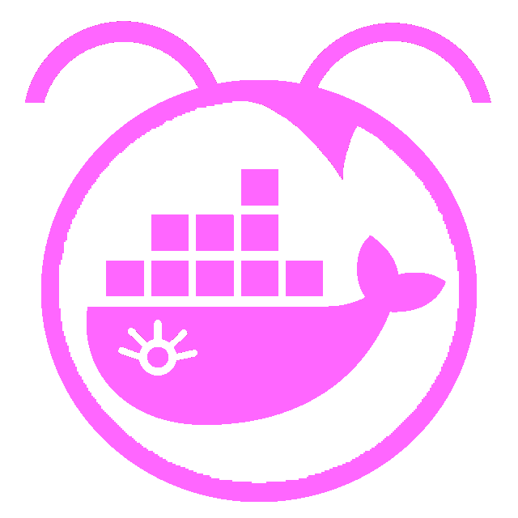

# Dockeria Home

> My online pages, and archives

  * All 4 [Homepage](index.html)
    - [Poems](./online/boathill/index.html)
    - [Zhou Lin](./online/angelfire/index.html)
    - [Zhou Yao](./online/all4/index.html)
    - [Zhu Hui](./online/all4/pages/zhuhui.htm)
  * Download arhives
    - [myvcd.iso](myvcd.iso)
    - [myvcd.mp4](myvcd.mp4)

---

## Dockerian Repositories

* blog and [poetry](https://github.com/dockerian/poetry) | **[web](https://dockerian.github.io/poetry/)** <a href="https://dockerian.github.io/poetry/" style="text-decoration:none">github.io pages</a> 
  Chinese/English poetry collection, study notes, and tools.

* [devtest](https://github.com/dockerian/devtest)  
  Automated Functional Tests for OpenStack Developer SDKs

* [shuati](https://github.com/dockeria/shuati)  
  Golang coding exercise

* [js-ui](https://github.com/dockerian/js-ui)  
  Prototype Web UI by JavaScript Frameworks

* [pyml](https://github.com/dockerian/pyml)  
  Python Moonlight (Machine Learning) Practice

 

&raquo; <a href="https://github.com/dockeria">Dockeria</a> at GitHub &laquo;
